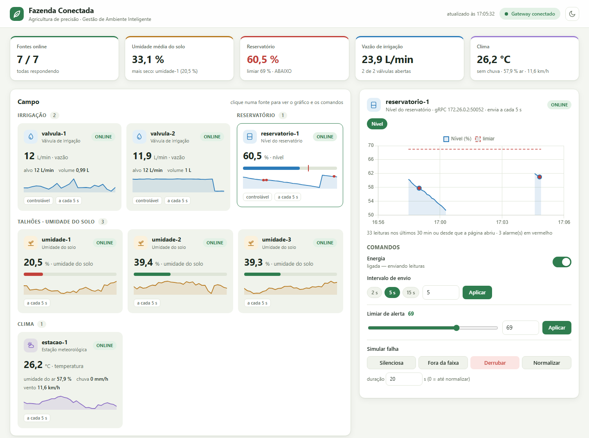

# Gestão de Ambiente Inteligente — Trabalho 1

Sistema distribuído de monitoramento e controle (Distribuição de Processos e Dados — Prof. Paulo A. L. Rego). Especificação em [`docs/especificacao-trabalho-1.pdf`](docs/especificacao-trabalho-1.pdf); acompanhamento na issue #1.

> **Domínio de aplicação:** agricultura de precisão (registrado no kickoff, #2): válvulas de irrigação, reservatório, umidade do solo dos talhões e estação meteorológica. O contrato das fontes usa o tipo como string, então não depende dessa escolha.

## Início rápido

```bash
docker compose up --build
```

Abra o dashboard em **http://localhost:8080**:



O dashboard mostra o campo em tempo real, os comandos para as fontes, as consultas e os alarmes. Para usar o CLI: `docker compose run --rm cli`. Detalhes em [Como rodar](#como-rodar), inclusive como rodar sem Docker.

## Arquitetura

```
Cliente (Node.js: CLI e dashboard web) ──TCP (protobuf)── Gateway (Python)
                                      │  ▲
                     gRPC (comandos)  │  │ UDP (fluxo de dados, protobuf)
                                      ▼  │
                  Fontes controláveis      Fontes contínuas
                (servidor gRPC + UDP)     (só UDP)        — Python
          ...... descoberta via UDP multicast (todas as fontes) ......
```

| O quê | Valor |
|---|---|
| Grupo multicast de descoberta | `224.1.1.1:5007` |
| Porta UDP do Gateway (anúncios + leituras) | `6000` |
| Porta TCP do Gateway (Cliente) | `7000` |
| Portas gRPC das fontes controláveis | `50051`, `50052`, ... |
| Porta HTTP do dashboard (extra) | `8080` |

## Como rodar

### Com Docker (recomendado — só precisa do Docker)

```bash
docker compose up --build        # Gateway + 7 fontes + dashboard, cada um no seu container
```

- **Dashboard:** http://localhost:8080
- **CLI:** `docker compose run --rm cli`
- **Logs:** `docker compose logs -f gateway` (ou o nome de uma fonte, ex.: `valvula-1`)
- **Comando direto numa fonte:** `docker compose exec gateway python -m gateway.commands valvula-1:50051 status`
- **Parar:** `docker compose down`. O histórico SQLite fica no volume `gateway-data`; `docker compose down -v` apaga.

Cada fonte é um container separado na mesma rede do Docker. A descoberta multicast, as leituras UDP e os comandos gRPC passam por essa rede, com um IP por fonte, como em máquinas diferentes. Uma fonte derrubada pela falha "queda do processo" fica parada até `docker compose start <fonte>`. As portas 7000 e 8080 só são publicadas em `127.0.0.1`, porque o Gateway e o dashboard não têm autenticação.

### Sem Docker

Requisitos: Python 3.11+ e Node.js 20+.

```bash
python -m venv .venv && .venv/bin/pip install -r requirements.txt
./scripts/gen_proto.sh          # gera pb/*_pb2*.py a partir de proto/ (Windows: PYTHON=.venv/Scripts/python ./scripts/gen_proto.sh)
./scripts/run_all.sh            # sobe Gateway + fontes, logs em logs/*.log
tail -f logs/*.log
./scripts/stop_all.sh
```

Componentes individuais:

```bash
.venv/bin/python -m gateway.main --rediscovery 10 --db data/gateway.db
.venv/bin/python -m sources.valve --id valvula-1 --grpc-port 50051 --interval 5          # controlável
.venv/bin/python -m sources.reservoir --id reservatorio-1 --grpc-port 50052 --interval 5   # controlável + evento
.venv/bin/python -m sources.soil_moisture --id umidade-1 --interval 15                     # contínua
.venv/bin/python -m sources.weather_station --id estacao-1 --interval 15                   # contínua, 4 grandezas
.venv/bin/python -m sources.base --id probe-1 --type PROBE --interval 5    # fonte de teste (só descoberta)
.venv/bin/python -m sources.simulated --id temp-1 --type SENSOR_TEMP --metric temperatura --unit °C \
    --base 25 --min -10 --max 50 --interval 5                              # fonte de teste com envio periódico
.venv/bin/python -m gateway.commands 127.0.0.1:50051 status                 # comando gRPC direto numa fonte controlável
```

Cliente (Node.js, requer o Gateway no ar):

```bash
cd client && npm install        # uma vez
node cli/index.js               # CLI interativo; --host / --port (padrão localhost:7000)
node web/server.js              # dashboard em http://127.0.0.1:8080 (extra); --gateway-host / --gateway-port / --port / --bind
```

Testes: `.venv/bin/python -m pytest` (Python) e `cd client && npm test` (Node). O teste `tests/test_node_python_interop.py` roda um cliente Node real contra o servidor TCP Python e é pulado se o `npm install` não tiver sido feito.

### Multicast e firewall

O `run_all.sh` usa a loopback (`DISTSYS_MCAST_IF=127.0.0.1`), que funciona em qualquer máquina. Para rodar em **várias máquinas** da mesma rede, use o IP da placa (`DISTSYS_MCAST_IF=192.168.0.10 ./scripts/run_all.sh`, ou `--mcast-if` em cada processo) e libere as portas no firewall — com `ufw`:

```bash
sudo ufw allow 5007/udp && sudo ufw allow 6000/udp
```

## Descoberta (UDP multicast)

1. O Gateway, ao iniciar e a cada `--rediscovery` segundos, envia `DiscoveryRequest` para `224.1.1.1:5007` com o IP/porta UDP onde quer receber respostas (requisito 4a).
2. Cada fonte, inscrita no grupo, guarda o endereço do Gateway e responde por UDP unicast com `SourceMessage{announcement}`: tipo, IP, porta gRPC e estado inicial (requisitos 2b e 4b).
3. A fonte só envia leituras depois de conhecer o Gateway. Se o Gateway reiniciar, a próxima redescoberta atualiza o endereço.

A redescoberta periódica cobre fontes que sobem depois do Gateway e fontes reiniciadas.

## Estado das fontes e detecção de falhas

O registro do Gateway (`gateway/registry.py`) mantém cada fonte em um de três estados:

| Estado | Quando |
|---|---|
| `ONLINE` | anúncio ou leitura recebidos recentemente |
| `OFFLINE` | nada recebido por 3 × o intervalo de envio (mínimo 5 s), ou gRPC indisponível |
| `DESLIGADA` | a fonte reportou `powered_on = false`; não expira por silêncio |

Uma fonte `OFFLINE` volta a `ONLINE` assim que manda uma leitura ou responde à redescoberta.

## Fluxo de dados (UDP)

```
fonte: sample() ──PeriodicPublisher──▶ UdpSender ──SourceMessage{reading}──▶ Gateway :6000
Gateway: GatewayUdpEndpoint ──▶ ReadingReceiver ──▶ registry.touch()   (estado ONLINE, última leitura)
                                               ├──▶ ReadingStore       (memória, 25 h, consultas)
                                               ├──▶ SqliteStorage      (disco, histórico)
                                               └──▶ is_event → ALARME no log + contagem por fonte
```

- **Fonte** (`sources/udp_sender.py`): `PeriodicPublisher` chama a função de amostragem a cada intervalo e envia pelo `UdpSender`. Nada sai antes da descoberta. `set_interval()` vale já para o próximo envio, `pause()`/`resume()` atendem o `SetPower` e `UdpSender.send(leitura, is_event=True)` faz o envio imediato por limiar (requisito 5c).
- **Valores simulados** (`sources/generator.py`): `ValueGenerator` = base + tendência + deriva lenta + ruído, limitado à faixa física. `spike()` força um pico (útil para disparar o limiar na demo).
- **Gateway** (`gateway/readings.py`): as janelas de tempo usam o relógio do Gateway na chegada (`received_ms`), então fontes com relógio errado não bagunçam as consultas. Leitura de fonte desconhecida é guardada e antecipa a redescoberta.

## Consultas agregadas (requisito 5d)

`gateway/queries.py` — genéricas por grandeza (`metric`), servem para qualquer domínio. Cada resultado traz o valor, a fonte associada, o ranking por fonte e uma frase pronta (`description`) para o Cliente exibir.

| Tipo | Resultado | Exemplo |
|---|---|---|
| `media` | média na janela | média de temperatura na última hora |
| `desvio_padrao` | desvio padrão amostral | desvio padrão de CO2 nas últimas 24 h |
| `minimo` / `maximo` | menor/maior leitura e a fonte | pico de consumo nas últimas 24 h |
| `soma` | soma das leituras | consumo de água em 24 h |
| `menor_media` / `maior_media` | fonte com menor/maior média | talhão mais seco, rack mais quente |
| `maior_variacao` | fonte com maior desvio padrão | fonte com maior variação nas leituras |
| `contagem_eventos` | alarmes (`is_event`) por fonte | leito com mais alarmes na última hora |

Filtros: `QueryFilter(metric, source_id, source_type)` + janela em segundos (até 30 dias). Janela vazia devolve `value = None` e "sem dados", sem erro. Janelas maiores que a retenção em memória são calculadas sobre o SQLite.

## Persistência (extra)

`gateway/storage.py` grava cada leitura em SQLite (`data/gateway.db`, `--db ""` desliga). As escritas vão para uma fila e uma thread grava em lote, então o receptor UDP nunca espera o disco. Ao reiniciar, o Gateway recarrega as últimas 25 h para a memória e as consultas continuam funcionando.

| Tabela | Conteúdo |
|---|---|
| `readings` | `source_id`, `source_type`, `received_ms`, `source_timestamp_ms`, `is_event` |
| `measurements` | `reading_id`, `metric`, `value`, `unit` (uma linha por grandeza) |
| `source_events` | comandos e mudanças de estado: `timestamp_ms`, `source_id`, `kind`, `detail` |

## Fontes do domínio — agricultura de precisão

Implementação do Enzo (branch `enzo/fontes-de-dados`) adaptada ao contrato acima: cada fonte estende `sources.datasource.DataSource`, que por sua vez estende o `SourceProcess` (descoberta) e envia pelo `UdpSender`.

| Fonte | Módulo | Tipo | Controlável | Grandezas | Comandos |
|---|---|---|---|---|---|
| Válvula de irrigação | `sources.valve` | `IRRIGATION_VALVE` | sim (`50051`, `50053`) | `vazao` (L/min), `volume` (L desde a leitura anterior) | ligar/desligar (abrir/fechar), intervalo, `vazao_alvo_lpm` (0–100), falha |
| Nível do reservatório | `sources.reservoir` | `RESERVOIR_LEVEL` | sim (`50052`) | `nivel` (%) | ligar/desligar, **limiar** (0–100 %), intervalo, falha |
| Umidade do solo | `sources.soil_moisture` | `SOIL_MOISTURE` | não | `umidade_solo` (%) | — |
| Estação meteorológica | `sources.weather_station` | `WEATHER_STATION` | não | `temperatura` (°C), `umidade_ar` (%), `chuva` (mm/h), `vento` (km/h) | — |

- **Evento imediato (requisito 5c):** o reservatório simula o nível a cada 1 s (consumo da irrigação + bomba que liga abaixo de 20 % e desliga acima de 85 %). Quando o nível **cai abaixo do limiar**, envia na hora uma leitura com `is_event = true`; quando volta acima de limiar + 1 %, envia outro evento ("nível normalizado"). Os dois aparecem como ALARME no Gateway.
- **Consumo de água:** `volume` é o que a válvula liberou desde a leitura anterior; a consulta `soma` sobre `volume` dá o consumo.
- **Umidade do solo:** cada `--id` tem média e variabilidade próprias, estáveis entre execuções.
- **Desligada** não envia leituras; o registro mostra `DESLIGADA` (estado vindo do gRPC), que não expira.
- **Comandos inválidos:** intervalo fora de 0,5–3600 s ou parâmetro/limiar fora da faixa → `INVALID_ARGUMENT`; limiar/parâmetro em fonte que não tem → `UNIMPLEMENTED`.

### Simulação de falhas (#8) — roteiro da demo

Com tudo no ar (`./scripts/run_all.sh`; acompanhe `logs/gateway.log`):

| Passo | Comando | O que aparece no Gateway |
|---|---|---|
| 1. Evento imediato | `./scripts/simulate_failure.sh event` | `ALARME de reservatorio-1` |
| 2. Fonte silenciosa | `./scripts/simulate_failure.sh silent 30` | `valvula-1: ONLINE → OFFLINE` após 3 × intervalo; volta a `ONLINE` sozinha no fim |
| 3. Queda de uma fonte contínua | `./scripts/simulate_failure.sh kill umidade-2` | `umidade-2: ONLINE → OFFLINE`; as outras seguem normais |
| 4. Valores absurdos | `./scripts/simulate_failure.sh garbage 30` | leituras da válvula fora da faixa (ex.: `vazao=150L/min`) |
| 5. Queda do processo | `./scripts/simulate_failure.sh crash` | `valvula-1: ONLINE → OFFLINE` |
| 6. Recuperação | `./scripts/simulate_failure.sh restart` | `valvula-1: OFFLINE → ONLINE` na próxima redescoberta |
| 7. Limpar | `./scripts/simulate_failure.sh recover` | limiar volta a 30 % (gera o evento "nível normalizado") |

O script fala direto com o gRPC das fontes (`python -m gateway.commands`); com o Cliente (#17) pronto, os mesmos comandos passam pelo Gateway. A fonte em falha `silent` também ignora a redescoberta (`SourceProcess.answers_discovery()`), senão o Gateway nunca a marcaria OFFLINE.

## Comandos para as fontes controláveis (gRPC) — `gateway/commands.py`

`CommandService.execute(source_id, Command.xxx(...))` procura a fonte no registro, chama a RPC com deadline de 2 s e devolve o `SourceStatus` novo, que também vai para `registry.update_status`. Os erros chegam como `CommandError(kind, message)`, com a mensagem pronta para o Cliente:

| `kind` | Quando | Efeito no registro |
|---|---|---|
| `FONTE_DESCONHECIDA` | id não está no registro | — |
| `NAO_CONTROLAVEL` | fonte contínua | — |
| `REJEITADO` | a fonte recusou (`INVALID_ARGUMENT`, `FAILED_PRECONDITION`, `OUT_OF_RANGE`, `UNIMPLEMENTED`) | continua como estava |
| `INDISPONIVEL` | sem resposta no deadline / conexão recusada | `mark_offline` |

- Um canal gRPC por fonte, reaproveitado; se a fonte reaparecer em outro IP/porta, o canal é trocado.
- Ao descobrir uma fonte controlável nova, o Gateway faz um `GetStatus` em segundo plano (fora da thread UDP) para sincronizar o estado.
- `SimulateFailure(CRASH)` bem-sucedido marca a fonte OFFLINE na hora.
- Cada comando vai para o histórico (`storage.record_event(source_id, "comando", ...)`).

Para testar uma fonte sem Gateway: `python -m gateway.commands <ip:porta> status | on | off | interval <s> | threshold <v> | param <nome> <v> | fail <none|silent|out_of_range|crash> [s]`.

## Contrato das fontes — `proto/sources.proto`

| Mensagem | Canal | Conteúdo |
|---|---|---|
| `DiscoveryRequest` | multicast, Gateway → fontes | `gateway_ip`, `gateway_udp_port`, `request_id`, `timestamp_ms` |
| `SourceAnnouncement` | UDP, fonte → Gateway | `source_id`, `type`, `ip`, `grpc_port` (0 = não controlável), `controllable`, `initial_state`, `request_id` |
| `SensorReading` | UDP, fonte → Gateway | `source_id`, `type`, `timestamp_ms`, `measurements[]` (`metric`, `value`, `unit`), `is_event` |
| `SourceMessage` | UDP, fonte → Gateway | envelope `oneof { announcement, reading }` — tudo que chega na porta 6000 |
| `SourceStatus` | descoberta e gRPC | `powered_on`, `send_interval_s`, `threshold` (opcional), `parameters` (mapa do domínio), `failure`, `failure_until_ms` |

Serviço gRPC `SourceControl` (fontes controláveis) — toda RPC devolve o `SourceStatus` atualizado:

| RPC | Request |
|---|---|
| `GetStatus` | `Empty` |
| `SetPower` | `PowerRequest { on }` |
| `SetSendInterval` | `IntervalRequest { interval_s }` |
| `SetThreshold` | `ThresholdRequest { threshold }` |
| `SetParameter` | `ParameterRequest { name, value }` |
| `SimulateFailure` | `FailureRequest { mode, duration_s }` — `FAILURE_SILENT`, `FAILURE_OUT_OF_RANGE`, `FAILURE_CRASH` |

## Contrato do Cliente — `proto/client.proto` e framing TCP

O Cliente (Node.js) fala com o Gateway por **TCP** (porta `7000`). Cada mensagem vai com framing: **4 bytes big-endian com o tamanho** do payload + bytes protobuf (`gateway/framing.py`, `client/framing.js`). O Cliente envia `ClientRequest`; o Gateway responde sempre com um `GatewayResponse` com o mesmo `request_id`. Erros viram `ErrorResponse` e a conexão continua aberta. O arquivo não importa `sources.proto`: o Gateway converte os tipos.

| Pedido (`ClientRequest`) | Resposta (`GatewayResponse`) | Requisito |
|---|---|---|
| `ListSourcesRequest` | `ListSourcesResponse { sources[] }` — `SourceInfo`: `source_id`, `type`, `ip`, `grpc_port`, `controllable`, `state` (ONLINE/OFFLINE/POWERED_OFF), `last_seen_ms`, `powered_on`, `send_interval_s`, `threshold` (opcional), `parameters`, `failure`, `last_values[]` | 3a.ii, 3b.i |
| `CommandRequest { source_id, oneof { power, interval, threshold, parameter, failure } }` | `CommandResponse { success, message, source }` — estado atualizado da fonte | 3a.iii, 3b.ii |
| `QueryRequest { query_type, source_id, source_type, metric, window_s }` | `QueryResponse { value, samples, details[] }` | 3b.iii, 5d |
| `HistoryRequest { source_id, from_ms, to_ms, metric }` (extra, #16) | `HistoryResponse { points[] }` | extra |
| qualquer um | `ErrorResponse { code, message }` — `INVALID_REQUEST`, `NOT_FOUND`, `NOT_CONTROLLABLE`, `SOURCE_UNAVAILABLE`, `UNSUPPORTED`, `INTERNAL` | — |

`query_type` é uma string (e não um enum) para não depender das consultas escolhidas no kickoff; os nomes oferecidos pelo CLI e pelo dashboard ficam em `client/query-presets.js`.

Servidor (`gateway/tcp_server.py`): uma thread por conexão, vários clientes simultâneos; um cliente que cai no meio de uma mensagem só encerra a própria conexão. O despacho (`gateway/client_dispatcher.py`) valida o pedido (fonte existe e é controlável, intervalo > 0, números finitos) antes de chamar os módulos dos outros fluxos (comandos, consultas e histórico, via `gateway/client_adapters.py`). Módulo ausente responde `ERROR_UNSUPPORTED` — ex.: histórico com `--db ""`.

## Cliente CLI e dashboard (Node.js)

```
client/framing.js          framing TCP (4 bytes + payload)
client/protocol.js         carrega proto/client.proto (protobufjs)
client/gateway-client.js   conexão, request_id, erros tipados — compartilhado por CLI e dashboard
client/cli/                menu interativo (listar, ligar/desligar, frequência, limiar, parâmetro, falha, consultas, histórico)
client/web/                Express (porta 8080) + página com Chart.js; fala HTTP com o navegador e TCP com o Gateway
```

O dashboard ("Fazenda Conectada") mostra:
- **Indicadores:** fontes online, umidade média do solo, nível do reservatório, vazão de irrigação e clima.
- **Cartões por tipo de fonte:** mini-curva das últimas leituras e barra de nível (no reservatório, com a marca do limiar). Destacam falha, alarme e OFFLINE.
- **Painel da fonte selecionada:** gráfico com a linha do limiar e os alarmes em vermelho, e os comandos (liga/desliga, intervalo, limiar, parâmetros e simulação de falha).
- **Consultas do domínio:** talhão mais seco, água irrigada, alarmes e temperatura média, além de uma consulta personalizada.
- **Linha do tempo:** alarmes, mudanças de estado e comandos.

Tem tema claro e escuro e funciona no celular. Para abrir direto numa fonte: `http://localhost:8080/#fonte=reservatorio-1`.

Se o Gateway estiver fora do ar, o CLI avisa e tenta reconectar a cada ação (leituras são repetidas até 3 vezes; comandos **não** são reenviados automaticamente para não serem aplicados duas vezes). O dashboard escuta só em `127.0.0.1` por padrão porque não tem autenticação; use `--bind 0.0.0.0` para abrir à rede.

## Estrutura e interfaces entre os módulos

```
proto/sources.proto       contrato Gateway ↔ fontes                     Marcelo
common/                   sockets, threads de fundo, logging            Marcelo
sources/config.py         argumentos das fontes                         Marcelo
sources/discovery.py      resposta à descoberta, endereço do Gateway    Marcelo
sources/base.py           SourceProcess (classe base das fontes)        Marcelo
gateway/discovery.py      DiscoveryRequest + registro dos anúncios      Marcelo
gateway/registry.py       registro de fontes + detecção de falhas       Marcelo
gateway/udp_endpoint.py   socket UDP do Gateway, despacho pelo oneof    Marcelo
gateway/readings.py       receptor de leituras + séries em memória      Enzo
gateway/queries.py        consultas agregadas                           Enzo
gateway/storage.py        persistência SQLite + histórico               Enzo
gateway/main.py           liga todos os módulos                         Marcelo
sources/udp_sender.py     UdpSender + PeriodicPublisher                 Enzo
sources/generator.py      gerador de valores simulados                  Enzo
sources/simulated.py      fonte contínua genérica (testes/demo)         Enzo
sources/datasource.py     base das fontes do domínio (DataSource)       Enzo (adaptado por Jon)
sources/control.py        servidor gRPC SourceControl                   Enzo (adaptado por Jon)
sources/cli.py            linha de comando das fontes                   Enzo (adaptado por Jon)
sources/valve.py, reservoir.py, soil_moisture.py, weather_station.py   Enzo
gateway/commands.py       cliente gRPC + handler de comandos             Jon
proto/client.proto        contrato Cliente ↔ Gateway                    LG
gateway/framing.py        framing TCP (4 bytes + protobuf)              LG
gateway/client_dispatcher.py  ClientRequest → módulos injetados         LG
gateway/client_adapters.py    contrato do Cliente ↔ comandos/consultas/histórico   integração
gateway/tcp_server.py     servidor TCP, uma thread por cliente          LG
client/                   CLI e dashboard (Node.js)                     LG
scripts/                  gen_proto.sh, run_all.sh, stop_all.sh         Marcelo
                          simulate_failure.sh                           Jon
Dockerfile, client/Dockerfile, docker-compose.yml   sistema completo em containers   Jon
tests/                    pytest (client/test/: node --test)
```

Pontos de encaixe para os outros fluxos:

| Para | Use |
|---|---|
| Novas fontes do domínio | estender `sources.datasource.DataSource` (definir `TYPE`, `MEASUREMENTS`, `PARAMETERS`/`THRESHOLD` e os hooks `update`/`measure`/`check_event`); fonte genérica de teste: `sources.base.SourceProcess` + `UdpSender`/`PeriodicPublisher` (exemplo em `sources/simulated.py`) |
| Consultas (LG, #15) | `gateway.queries.run(tipo, QueryFilter(...), janela_s)` → `QueryResult` (`value`, `source_id`, `per_source`, `description`); erro de parâmetro = `QueryError` |
| Histórico (LG, #15) | `gateway.storage.history(source_id, inicio_ms, fim_ms, metric=None, limit=None)` → leituras em ordem cronológica (`None` se rodando com `--db ""`) |
| Comandos/estado (Jon #13, Marcelo #11) | `gateway.storage.record_event(source_id, "comando", "SetPower(off)")` — opcional, aparece no histórico |
| Comandos (LG, #15) | `gateway.commands.execute(source_id, Command.power(False))` → `SourceStatus`; erro = `CommandError` (`kind`, `message`). Construtores: `status()`, `power(on)`, `interval(s)`, `threshold(v)`, `parameter(nome, v)`, `failure(modo, s)`; `Command.parse(["interval", "5"])` aceita texto |
| Servidor TCP (LG, #15) | `registry.list()` / `registry.get()` — devolvem cópias, seguras para ler fora do lock |
| Cliente TCP ↔ módulos | já ligado em `gateway/main.py`: `gateway/client_adapters.py` converte `CommandRequest` → `Command` (e `CommandError` → `ErrorResponse`), os filtros/janela da `QueryRequest` para o `QueryEngine` (`window_s` 0 = 30 dias) e as leituras do SQLite para `HistoryPoint` |

## Equipe

| Pessoa | Responsabilidade |
|---|---|
| Marcelo | contratos, descoberta, registro, infraestrutura |
| Enzo | fluxo de dados (UDP), consultas, persistência, slides |
| Jon | fontes e controle (gRPC), integração final, dashboard "Fazenda Conectada" e Docker |
| LG | Cliente e protocolo TCP (Node.js) |
